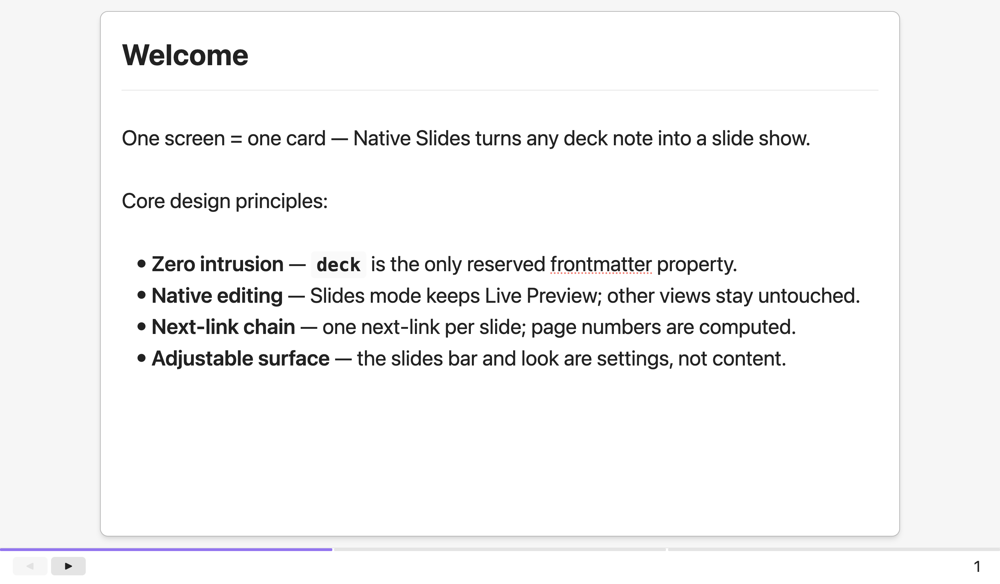

# Native Slides — 面向 deck 笔记的 Slides 模式

[English](README.md) | **简体中文**

> 一个 Obsidian 插件：把 deck 笔记变成 **Slides**——沉浸式、可编辑（Live Preview）的
> "一屏一卡"视图，slides 栏提供属性展示与 PPT 式翻页——由一个 frontmatter 属性驱动。

## 安装

需要 Obsidian 1.7.2 或更新版本，仅桌面端。

- **从社区插件目录安装**：_设置 → 第三方插件 → 浏览_，搜索 **Native Slides**，点击**安装**并**启用**。
- **手动安装**：从[最新 release](https://github.com/l05k/obsidian-native-slides/releases/latest) 下载 `main.js`、`manifest.json` 与 `styles.css`，放进 `<你的库>/.obsidian/plugins/native-slides/`，再在 _设置 → 第三方插件_ 中启用 **Native Slides**。

## 快速开始

1. 在一篇笔记的 frontmatter 里加上保留属性 `deck: []`，或运行 **Initialize slides with this note** 命令。这篇笔记就成了单页 deck。
2. 按 `Cmd/Ctrl+Shift+E`（**Toggle slides mode**）进入 Slides 模式，再按一次退出。
3. 按 `Cmd/Ctrl+Shift+N`（**Create next slide**）在当前页之后加一页，`deck` 链接会自动接好。
4. 用 `Cmd/Ctrl+Shift+←/→` 翻页，运行 **Show slides panel** 可纵览并重排整套 deck。

想先看一套成品，把本仓库的 [`example-vault/`](example-vault/) 作为库打开，在其中启用一次 **Native Slides**（[详情](docs/usage-zh.md#示例库)），再读 `Welcome.md`。

## 功能特性

- **Slides 模式**（仅 deck 笔记）：沉浸式、可编辑的卡片视图，一屏一卡，带六套样式模板，卡片标题可取自任意属性。
- **原生模式保持不动**：Source、Live Preview 与阅读视图保持 Obsidian 的行为。Slides 模式是插件的唯一界面。
- **只用一个属性 `deck`**：每页链接到下一页，这条链就是 deck。页号自动计算，从不存储。
- **Slides 栏**：可配置的属性列、◀ ▶ 按钮与页号。
- **Slides 面板**：侧边栏列出整套 deck，可创建、删除，并拖动幻灯片重排。
- **演示**：让光标失焦、隐藏鼠标指针，并复制一份感知布局的 AI 提示词。
- **命令随上下文显隐**：每个命令只在适用的地方出现在命令面板中。

每项功能的细节、命令表与设置见[使用指南](docs/usage-zh.md)。

## 文档

- **[使用指南](docs/usage-zh.md)**（[English](docs/usage.md)）：全部功能、命令与设置，Slides 面板，示例库与已知限制。
- **[设计原则与工作原理](docs/design-zh.md)**（[English](docs/design.md)）：指导每项改动的四大原则，以及 Slides 模式、deck 链与创建类命令的机制。
- **[开发](docs/development-zh.md)**（[English](docs/development.md)）：构建、开发循环、在 `example-vault/` 中测试，以及 agent skills。
- **[贡献指南](CONTRIBUTING.md)**与**[更新日志](CHANGELOG.md)**。

## 已知限制

- **仅桌面端**，暂不支持移动端。
- Slides 模式仅作用于 deck 笔记，其它笔记保持原生。
- 属性来源是 frontmatter，正文中的 `key:: value` 内联属性不读取。
- 在 Slides 面板里移动幻灯片会写 frontmatter，因此 `Cmd/Ctrl+Z` 无法撤销。

完整列表见[使用指南](docs/usage-zh.md#已知限制)。

## 许可证

本项目基于 [MIT License](LICENSE) 发布。Copyright (c) 2026 Yuanhui Luo。

## 致谢

- **Lecture (jyy) 样式模板**：参考 [jyywiki.cn](https://jyywiki.cn/) 的幻灯片卡片设计，作者 [蒋炎岩（Yanyan Jiang）](https://jyywiki.cn/)。卡片几何（80vw 宽度、柔和阴影、标题底部细线、实心圆点列表、列表项间距）均改编自蒋炎岩的讲义笔记设计。
